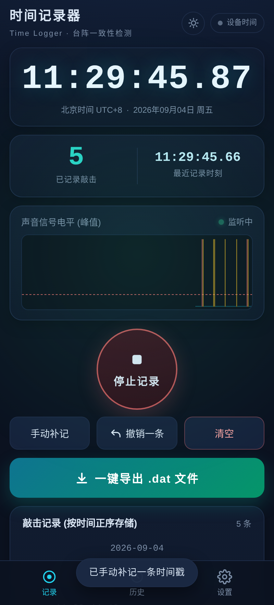
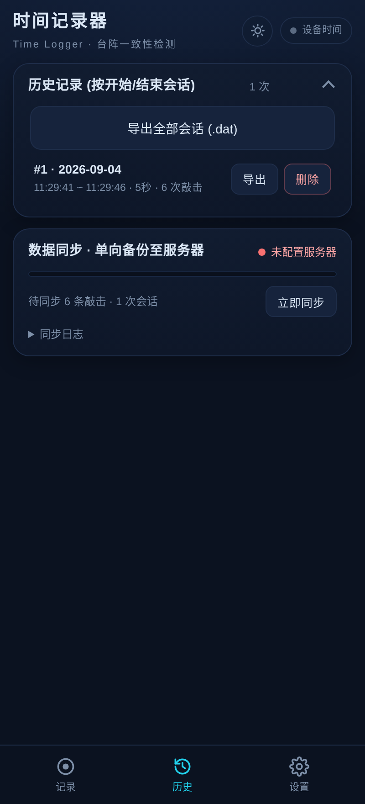
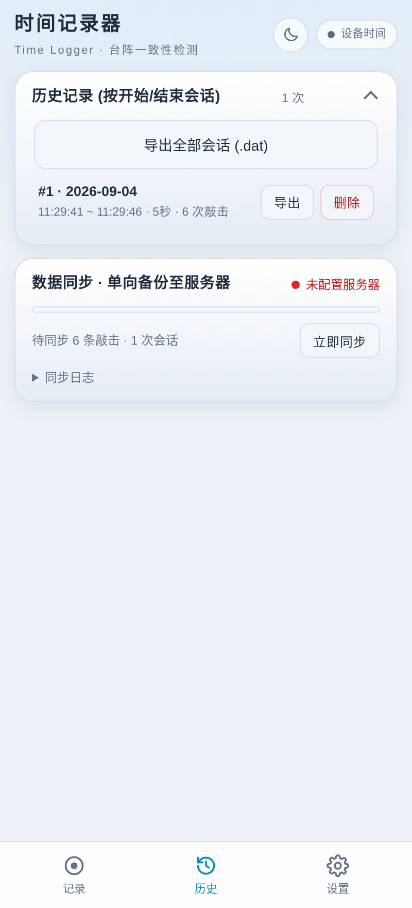
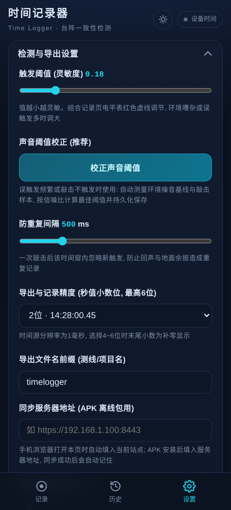

# 时间记录器 Time Logger

地震密集台阵设备一致性检测 —— 锤击时刻的精确记录工具。

通过 Web Audio API 监听设备麦克风，自动检测敲击瞬态声波并定位起始样本，补偿音频链路延迟后记录精确北京时间（UTC+8，秒值小数位最高 6 位）。项目包含三个部分：

- **Web 前端**：单页应用，免安装，手机浏览器打开即用
- **服务端**：零依赖 Node.js HTTPS 静态服务器（浏览器只有在 HTTPS 安全上下文下才允许访问麦克风），同时提供单向数据同步备份接口
- **Android 客户端**：基于 [Capacitor](https://capacitorjs.com/) 打包的离线 APK

## 功能特性

- 🎙️ **自动检测敲击**：基于阈值触发的瞬态声波检测，可调触发阈值与防重复间隔
- ⏱️ **高精度时间戳**：北京时间 UTC+8，秒值小数位 2~6 位可配置，支持附加时间补偿
- 📑 **三标签导航**：底部导航栏分为「记录 / 历史 / 设置」三个视图，功能分区清晰
- 🗂️ **历史视图**：会话列表（导出/删除）、数据同步状态与日志集中管理，切屏即达
- 💾 **本地持久化**：数据存入 IndexedDB（旧版本 localStorage 记录自动迁移），断网可用
- 📤 **`.dat` 导出**：纯文本格式，每行一条时间戳，可直接用于后续数据处理
- ☁️ **自动同步备份**：停止记录后自动增量上传至服务器，带 SHA-256 完整性校验、失败退避重试、断网续传，按设备落盘；网页版自动填入当前站点作为同步地址，APK 会记住上次同步成功的服务器；同步令牌仅在服务器启用 `SYNC_TOKEN` 校验时才会显示
- 📱 **PWA 支持**：可添加到主屏幕，全屏独立运行
- 🌗 **深浅色主题**：一键切换深色/浅色界面，选择持久保存，刷新不闪烁
- 🖥️ **沉浸式状态栏**：APK 内系统状态栏/导航栏全透明，内容延伸至其下，状态栏图标颜色随主题自动切换

## 界面预览

| 记录 | 历史 |
| --- | --- |
|  |  |

| 浅色主题 | 设置 |
| --- | --- |
|  |  |

## 项目结构

```
time-logger/
├── server.js            # 零依赖 Node.js HTTPS 服务器 + 同步备份接口
├── package.json
├── start.sh / stop.sh   # 服务器启停脚本（后台运行，记录 PID 与日志）
├── web/                 # Web 前端（服务端静态目录）
│   ├── index.html
│   ├── app.js           # 检测/记录/导出/同步核心逻辑
│   ├── style.css
│   └── logo.png         # 应用图标
├── mobile/              # Android 客户端（Capacitor）
│   ├── capacitor.config.json
│   ├── www/             # web/ 的离线副本（npm run sync-web 同步）
│   └── android/         # Capacitor 生成的 Android 工程
└── data/                # 运行时生成：各设备同步备份数据（不入库）
```

## 快速开始（Web 版）

### 环境要求

- Node.js ≥ 14
- OpenSSL（首次运行自动生成自签名证书，有效期 10 年）

### 启动服务器

```bash
# 方式一：npm
npm start

# 方式二：脚本（后台运行）
./start.sh          # 默认端口 8443，可用 ./start.sh 9443 指定端口

# 停止
./stop.sh
```

启动后终端会打印本机局域网地址，手机与电脑连接同一 Wi-Fi/热点，用浏览器打开即可，例如：

```
https://192.168.1.100:8443
```

> 自签名证书首次访问不受信任：Android Chrome 点「高级 → 继续访问」；iOS Safari 点「显示详细信息 → 访问此网站」。

### 环境变量

| 变量 | 默认值 | 说明 |
| --- | --- | --- |
| `PORT` | `8443` | HTTPS 服务端口 |
| `HTTP_PORT` | `8080` | HTTP 跳转端口（访问 http 自动 301 到 https） |
| `SYNC_TOKEN` | 空 | 设置后客户端须在「设置 → 同步令牌」填入相同值才允许同步 |

### 数据同步与备份

客户端 IndexedDB → 服务器单向同步，接口如下：

- `POST /api/sync`：接收敲击记录与会话数据，校验 SHA-256 完整性后落盘，按唯一键去重（幂等）
- `GET /api/sync/stats`：汇总各设备备份数量与最近同步日志，供运维查看

数据落盘在 `data/<设备ID>/`：

```
hits.jsonl     # 敲击记录，一行一条 JSON（追加式）
sessions.json  # 会话记录，每次同步覆盖保存最新状态
sync.log       # 服务器侧同步日志
```

运维查看示例：

```bash
curl -sk https://<本机IP>:8443/api/sync/stats
```

## Android 客户端

### 环境要求

- Node.js、Android Studio（或 Android SDK + Gradle）

### 构建步骤

```bash
cd mobile
npm install
npm run sync-web     # 同步 web/ 前端到 www/ 并刷新 Android 工程
npm run open-android # 用 Android Studio 打开工程，Run 或 Build APK
```

命令行打包：

```bash
cd mobile/android
./gradlew assembleDebug      # 调试包
./gradlew assembleRelease    # 发布包（需配置签名）
```

### 沉浸式状态栏

APK 内系统状态栏与导航栏全透明，网页内容延伸到系统栏之下（边到边布局），顶部安全距离由前端 `html.is-native` 样式自动处理；状态栏图标颜色随应用深浅色主题自动切换（实现在 `MainActivity.java` 与 `SSLTrustWebViewClient.java`）。

> ⚠️ 签名密钥库（`*.keystore`）与私钥（`*.pem`）已在 `.gitignore` 中排除，**切勿提交到仓库**，请在本地妥善备份。发布版 APK 建议通过 GitHub Releases 分发。

## 安全说明

- HTTPS 使用自签名证书，仅适用于局域网场景；`cert.pem` / `key.pem` 由服务器首次运行自动生成，不入库
- 若部署在多人可访问的网络中，建议设置 `SYNC_TOKEN` 环境变量防止匿名写入
- 用户数据只存在设备本地与自建服务器，本项目不收集、不上传任何第三方

## 许可证

[MIT](LICENSE)（如需其他许可证请自行修改）
